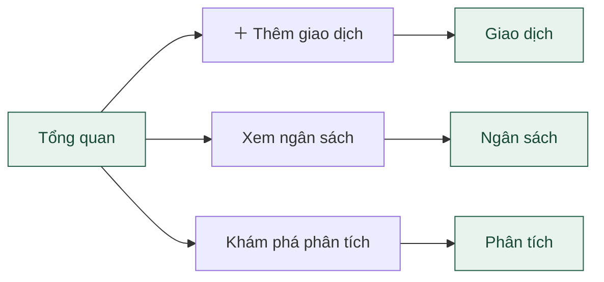
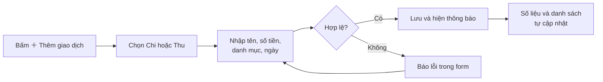
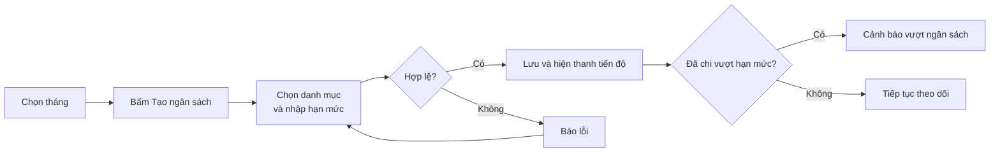
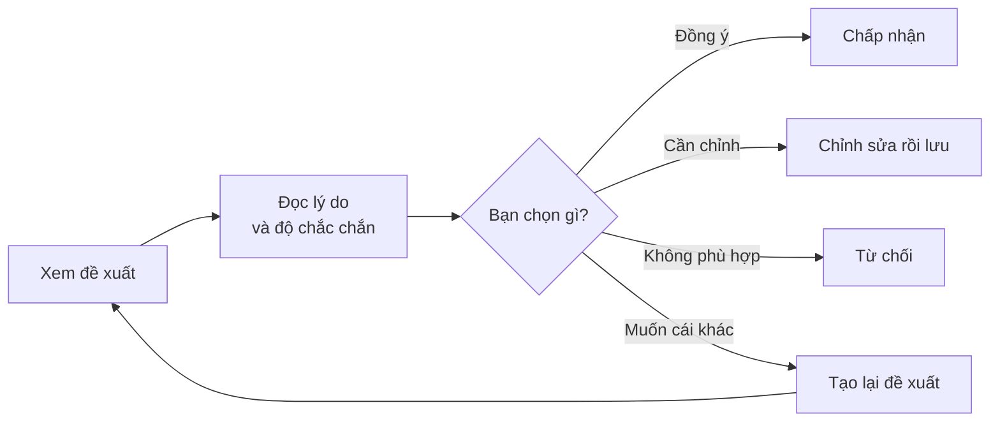

# User flow – Người dùng (SpendWise)

Cách đọc: mũi tên chỉ bước tiếp theo. Ô **tô màu** là màn hình, ô viền thường là hành động.

## 1. Bức tranh tổng quát

Người dùng đi từ trái sang phải. Thực tế có thể bấm menu bên trái để nhảy tới bất kỳ màn hình nào.

## 2. Tổng quan → đi đến đâu?

## 3. Giao dịch: thêm một khoản chi

Ngoài ra trên màn hình này: **Tìm kiếm / Lọc**, **Sửa**, **Xóa** và **Xuất dữ liệu**. Nếu lọc không ra kết quả, trang hiện trạng thái rỗng.

## 4. Ngân sách: đặt hạn mức cho một danh mục

Số đã chi được tính tự động từ các giao dịch. Nếu tháng chưa có ngân sách, trang hiện trạng thái rỗng.

## 5. Gợi ý AI: xử lý một đề xuất

Nếu AI lỗi hoặc không chắc chắn, hệ thống báo cho người dùng và cho nhập tay.

## 6. Bảng tóm tắt các màn hình

| Màn hình | Người dùng làm gì |
|---|---|
| Tổng quan | Xem nhanh số dư, thu, chi, ngân sách, giao dịch gần đây |
| Giao dịch | Thêm, sửa, xóa, tìm kiếm, lọc, xuất dữ liệu |
| Ngân sách | Đặt hạn mức theo danh mục, theo dõi tiến độ, nhận cảnh báo |
| Mục tiêu | Tạo mục tiêu tiết kiệm, cập nhật tiến độ |
| Phân tích | Xem biểu đồ và insight chi tiêu |
| Gợi ý AI | Xem đề xuất, chấp nhận, sửa hoặc từ chối |

> Luồng Giao dịch, Ngân sách, Gợi ý AI dựa trên HTML. Mục tiêu và Phân tích là mô tả chung, chưa đối chiếu chi tiết với `goals.html` và `insights.html`.
